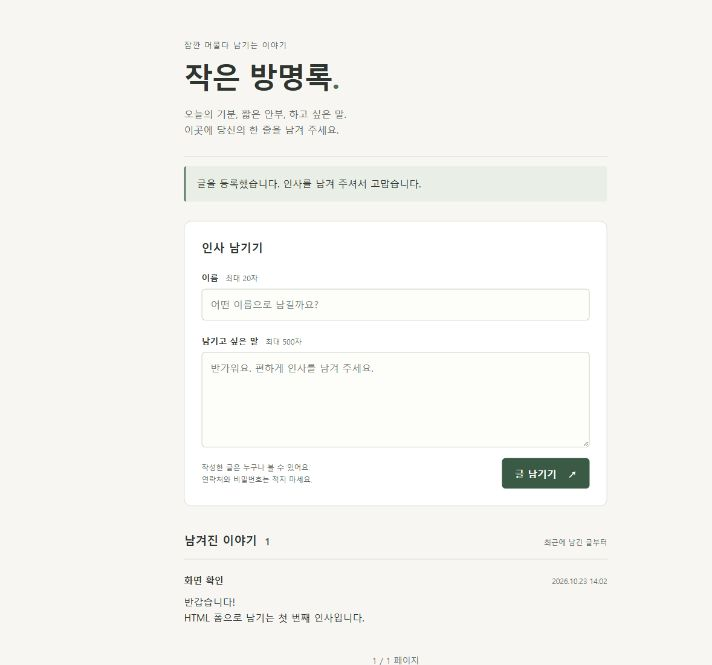

# Day1~Day8 방명록 프로젝트

작성일: 2026-10-23 (Asia/Seoul)

현재 단계: **방명록 구현 및 로컬 검증 완료**. 외부 서비스에는 아직 배포하지 않았습니다.

FastAPI로 HTML 폼을 받아 SQLite에 저장하는 작은 방명록입니다. 이름·내용 입력, 최신순 목록, 페이지 이동을 지원합니다. JavaScript와 외부 API는 사용하지 않습니다.

## 실행하기

현재 작업 PC에는 이 폴더의 `.venv`에 실행·테스트 패키지가 설치되어 있습니다. 작업 공간 루트의 PowerShell에서 다음을 실행합니다.

```powershell
cd Day1-Day8
.\.venv\Scripts\python.exe main.py
```

브라우저에서 **http://127.0.0.1:8000**을 엽니다. 종료하려면 실행 중인 터미널에서 `Ctrl+C`를 누릅니다. `main.py`를 더블클릭하거나 HTML 파일을 직접 여는 방식이 아니라 Python 서버를 실행해야 합니다.

이미 서버가 켜져 있으면 주소로 바로 접속합니다. `8000` 포트 사용 중 오류가 나면 중복 실행한 서버를 종료하거나 다음처럼 다른 포트로 실행합니다.

```powershell
.\.venv\Scripts\python.exe -m uvicorn main:app --host 127.0.0.1 --port 8001
```

새 PC에서는 Python 3.10 이상을 설치하고, 이 폴더에서 먼저 다음 명령을 실행합니다. 실제 검증에 사용한 버전은 Python 3.13입니다.

```powershell
py -m venv .venv
.\.venv\Scripts\python.exe -m pip install -r requirements.txt
```

가상 환경을 활성화하지 않아도 위 경로로 실행할 수 있습니다. 시스템의 `py main.py`만 실행하면 가상 환경에 설치한 FastAPI를 찾지 못할 수 있습니다.

## 사용과 저장

1. 이름과 내용을 입력하고 **글 남기기**를 누릅니다.
2. 서버가 앞뒤 공백을 제거하고 길이를 검사합니다.
3. 정상 입력이면 저장 후 목록으로 이동합니다. 잘못된 입력이면 작성 내용을 남겨 두고 안내합니다.

| 항목 | 구현 내용 |
| --- | --- |
| 저장 파일 | `data/guestbook.db`, 처음 서버를 시작할 때 자동 생성 |
| 테이블 | `guestbook` 하나: `id`, `name`, `message`, `created_at` |
| 이름 / 내용 | 각각 1~20자 / 1~500자, 공백만 입력 불가 |
| 저장 상한 | 1,000개. 초과 시 기존 글을 지우지 않고 새 등록 거부 |
| 목록 | 최신순, 한 페이지 10개 |
| 요청 크기 | URL 인코딩된 본문 전체 16 KiB 이하 |
| 작성 시각 | 한국 시간(UTC+09:00), 서버에서 기록 |

DB는 프로그램을 종료하고 다시 실행해도 유지됩니다. 공개 화면에 이름과 글이 표시되므로 개인정보는 적지 않습니다. 로그인·수정·삭제·파일 업로드 기능은 없습니다.

기본 DB 경로는 `main.py` 위치를 기준으로 정해집니다. 필요하면 실행 전에 `GUESTBOOK_DB` 환경 변수에 다른 DB의 절대 경로를 설정할 수 있습니다. 브라우저 검증에 사용한 `data/preview.db`는 별도의 확인용 파일이며, 일반 실행에서는 읽지 않습니다.

등록 후 303 응답으로 목록을 다시 조회하므로 결과 화면 새로고침은 글을 다시 쓰지 않습니다. 빠른 이중 클릭까지 완전히 방지하는 기능은 아닙니다. 글 수·길이 제한은 저장량을 줄이지만 트래픽이나 스팸 전체를 제한하지는 않습니다.

## 파일 구성

| 파일 | 역할 |
| --- | --- |
| [main.py](main.py) | 서버, 입력 검사, SQLite 저장·조회, HTML 응답 |
| [templates/index.html](templates/index.html) | 입력 폼과 목록 화면의 틀 |
| [static/style.css](static/style.css) | 최소한의 반응형 화면 스타일 |
| [requirements.txt](requirements.txt) | 실행용 패키지 버전 |
| [requirements-dev.txt](requirements-dev.txt) | 실행 패키지 + 기존 pytest·HTTPX 테스트 도구 |
| [test_guestbook.py](test_guestbook.py) | 임시 DB를 사용하는 28개 검증 사례 |

앱에서 직접 사용하는 기존 외부 패키지는 FastAPI, Pydantic, Uvicorn이며, 승인받아 추가한 패키지는 `python-multipart`입니다. 이 패키지들이 필요로 하는 하위 패키지는 pip가 함께 설치합니다. SQLite·HTML 특수문자 변환·문자열 템플릿은 Python 표준 라이브러리로 처리합니다.

## 테스트

이 폴더에서 실행합니다. 테스트 DB는 `.test-tmp` 아래에 만들며 실제 `data/guestbook.db`를 변경하지 않습니다.

```powershell
.\.venv\Scripts\python.exe -m pip install -r requirements-dev.txt
py -m py_compile main.py test_guestbook.py
.\.venv\Scripts\python.exe -m pytest test_guestbook.py -q --basetemp=.test-tmp
```

검증 결과: **28 passed**. 기존 HTTPX를 유지하여 TestClient 관련 사용 중단 예정 경고 1건이 있으며 테스트 실패는 없습니다. 자세한 결과는 [VERIFICATION.md](VERIFICATION.md)에 기록했습니다.

## 문서

| 문서 | 내용 |
| --- | --- |
| [ANALYSIS.md](ANALYSIS.md) | 기존 문법·알고리즘과 방명록 적용 방법 |
| [PROPOSAL.md](PROPOSAL.md) | 확인받을 라이브러리, 화면, 테이블, 처리 순서 |
| [CODE_GUIDE.md](CODE_GUIDE.md) | 처음 읽는 사람을 위한 코드 흐름 |
| [VERIFICATION.md](VERIFICATION.md) | 실제 검증 결과와 범위 |
| [DEPLOYMENT.md](DEPLOYMENT.md) | 무료 배포 후보, 제한, 배포 절차 |
| [학습 기록](glossary/2026-10-23-guestbook-design.md) | 이번 요청과 분석 답변 |

2026-10-23 후속 요청에서 패키지와 SQL 저장·조회, HTML 특수문자 처리, 등록 후 목록 이동 방식의 사용을 승인받고 구현했습니다. 원본 Day1~Day8 학습 파일은 수정하지 않았습니다.

이번 작업의 모든 산출물을 이 폴더에 두라는 요청에 맞춰 학습 기록도 이 폴더의 `glossary/`에 저장합니다.

## 화면 예시

브라우저 검증용 DB에 예시 글을 등록한 화면입니다. 실제 기본 DB는 비어 있는 상태로 시작합니다.


